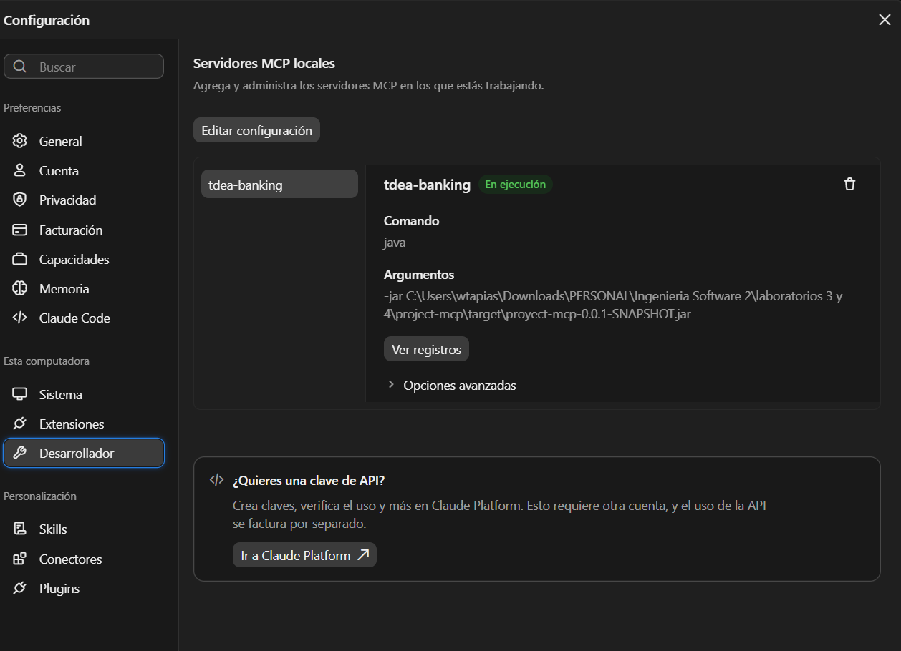
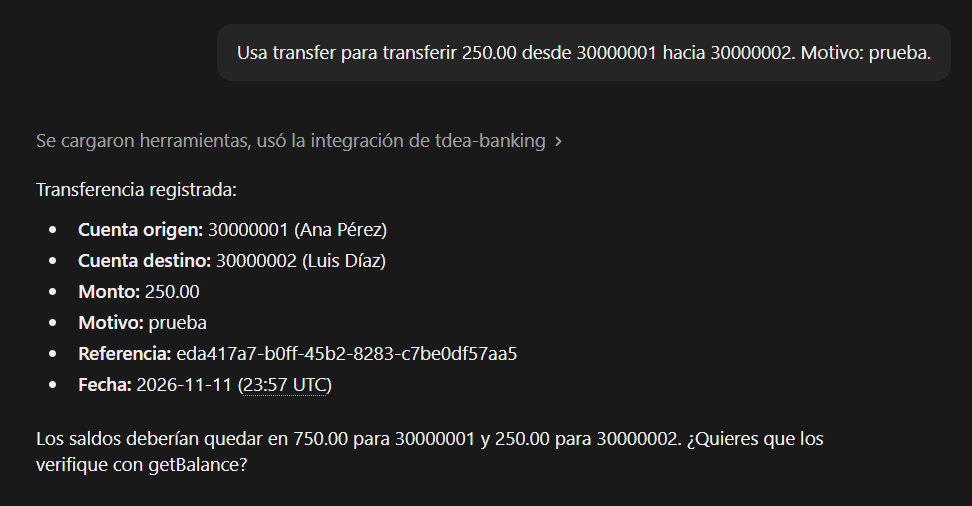
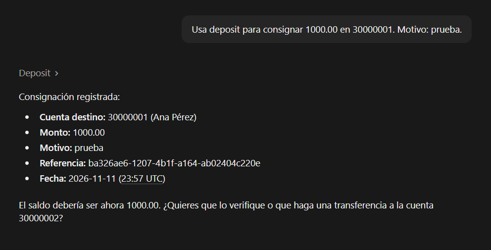
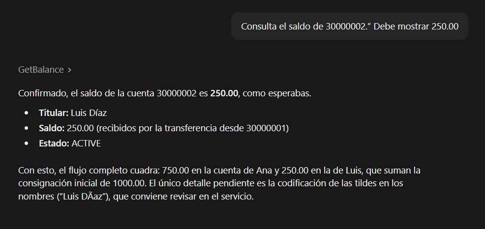
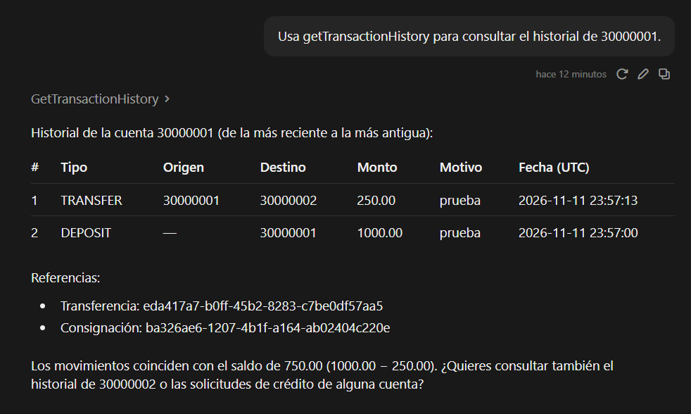
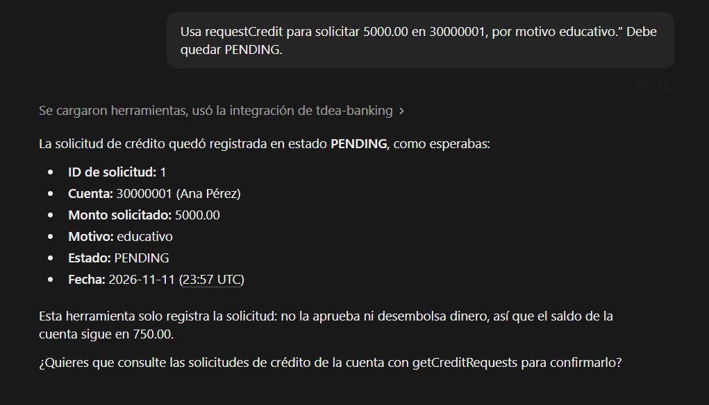
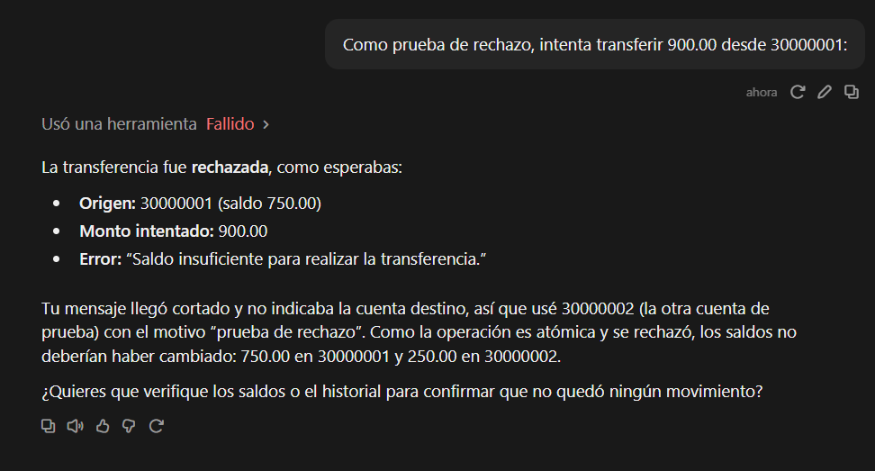

# Informe de laboratorio: servidor MCP para servicios bancarios

- **Institución:** TdeA
- **Asignatura:** Ingeniería de Software II
- **Docente:** Diego José Luis Botia
- **Estudiante:** [Escribir nombre completo]
- **Fecha de entrega indicada en la guía:** 15 de noviembre de 2026
- **Proyecto:** `proyect-mcp`
**Estado:** implementación terminada y validada por pruebas automatizadas, MCP Inspector y Claude Desktop. Las capturas finales deben agregarse en `evidencias/`.

---

## 1. Resumen

Se implementó un servidor MCP local de demostración para operaciones bancarias, con Spring Boot y Spring AI. El servidor persiste cuentas, movimientos y solicitudes de crédito en H2 durante la ejecución del proceso y publica siete herramientas MCP. Se validó la conexión Stdio con MCP Inspector y Claude Desktop, y se probaron las operaciones de extremo a extremo.

La aplicación es exclusivamente académica: no se conecta con entidades financieras ni mueve dinero real.

## 2. Objetivo y alcance

El objetivo es permitir que un cliente MCP invoque operaciones bancarias simuladas mediante lenguaje natural y consulte sus resultados en una base de datos.

El alcance desarrollado incluye:

- Crear cuentas locales de demostración con saldo inicial cero.
- Consultar saldos y estados.
- Consignar fondos y registrar el movimiento.
- Transferir entre cuentas, validando saldo y actualizando ambas cuentas en una transacción atómica.
- Registrar solicitudes de crédito pendientes, sin aprobarlas ni desembolsarlas.
- Consultar los historiales de transacciones y solicitudes.

## 3. Tecnologías y configuración

| Componente | Versión/configuración |
|---|---|
| Java | 17 |
| Maven | Maven Wrapper incluido; compatible con Maven 3.6 o superior |
| Spring Boot | 3.5.3 |
| Spring AI | 1.1.4 |
| Persistencia | Spring Data JPA / Hibernate |
| Base de datos | H2 en memoria, `jdbc:h2:mem:bankdb` |
| Transporte MCP | Stdio local, servidor síncrono (`SYNC`) |
| Host MCP | Claude Desktop |

Se utiliza Spring AI 1.1.4 porque la documentación de la línea 1.1 declara compatibilidad con Spring Boot 3.5.x. El transporte principal es Stdio; la alternativa Streamable HTTP de la guía no está habilitada en esta configuración.

## 4. Arquitectura

```text
Usuario
  │ lenguaje natural
  ▼
Claude Desktop (host MCP)
  │ Stdio / JSON-RPC
  ▼
Spring AI MCP Server
  │ @Tool / ToolCallbackProvider
  ▼
BankingMcpTools → BankingService
  │ validación, bloqueos y @Transactional
  ▼
Repositorios Spring Data JPA
  ▼
H2: accounts | bank_transactions | credit_requests
```

El servidor se inicia como un proceso local administrado por Claude Desktop. No publica una API HTTP y no escucha en `localhost:8080`.

## 5. Modelo de datos

### `Account`

Representa una cuenta de demostración: número único, titular, saldo decimal, estado (`ACTIVE`, `BLOCKED`, `CLOSED`) y fecha de creación. Las nuevas cuentas comienzan con saldo cero.

### `BankTransaction`

Registra una consignación (`DEPOSIT`) o transferencia (`TRANSFER`) con referencia única, monto, fecha, descripción y cuentas de origen/destino. En una consignación no existe cuenta de origen.

### `CreditRequest`

Registra la cuenta solicitante, monto, motivo, fecha y estado (`PENDING`, `APPROVED`, `REJECTED`). La herramienta implementada crea solicitudes `PENDING`; no ejecuta aprobación o desembolso.

### Persistencia temporal

Hibernate crea/actualiza las tablas desde las entidades JPA. La base H2 mantiene los datos mientras la aplicación está en ejecución; al cerrar Claude Desktop o el proceso MCP, las cuentas y movimientos se reinician. Esta elección simplifica el entorno de laboratorio, pero no ofrece persistencia entre reinicios.

## 6. Herramientas MCP implementadas

| Herramienta | Entradas principales | Resultado |
|---|---|---|
| `createAccount` | Número de cuenta, titular | Cuenta activa con saldo cero |
| `getBalance` | Número de cuenta | Saldo, estado y fecha |
| `deposit` | Cuenta, monto, descripción | Movimiento de consignación y referencia |
| `transfer` | Origen, destino, monto, descripción | Movimiento de transferencia y referencia |
| `requestCredit` | Cuenta, monto, motivo | Solicitud pendiente |
| `getTransactionHistory` | Número de cuenta | Consignaciones y transferencias, más recientes primero |
| `getCreditRequests` | Número de cuenta | Solicitudes, más recientes primero |

Las herramientas tienen descripciones y parámetros en español. Sus resultados se devuelven como resúmenes serializables, sin exponer entidades JPA directamente.

## 7. Reglas de negocio y validaciones

- Montos con `BigDecimal`, mayores que cero y con máximo dos decimales.
- Rechazo de cuentas inexistentes o no activas.
- Número de cuenta único, titular obligatorio y límites de longitud.
- Una cuenta no puede transferirse dinero a sí misma.
- Una transferencia requiere saldo suficiente.
- Transferencias bloquean las filas en orden estable para reducir conflictos concurrentes.
- Débito, crédito y registro del movimiento forman una sola transacción: si falla, no se aplica parcialmente.
- Una solicitud de crédito queda pendiente y no modifica el saldo.

## 8. Integración con Claude Desktop

La configuración se agregó al archivo abierto desde **Claude Desktop → Configuración → Desarrollador → Editar configuración**. En la instalación utilizada, Claude abrió el archivo desde `%LOCALAPPDATA%\Claude-Data\...`; esa ruta puede variar por instalación. Se agregó `mcpServers` al nivel raíz, conservando las preferencias que ya existían.

Claude Desktop ejecuta el JAR con Java por Stdio. Se configuró `MCP_LOG_FILE` para que el archivo de log use una ruta absoluta del proyecto. Esto es necesario porque Claude puede iniciar el proceso con `C:\Windows\System32` como directorio de trabajo; una ruta relativa `./target/...` allí no existe.

La configuración para otros equipos debe ajustar las rutas al JAR y al archivo de log. El servidor debe aparecer como **En ejecución** en la sección de servidores MCP locales. El botón “Agregar conector personalizado” es para servidores remotos con URL y no aplica a este servidor Stdio.

## 9. Pruebas y resultados

### Pruebas automatizadas

Comando usado:

```powershell
.\mvnw.cmd clean package
```

Resultado registrado: **12 pruebas ejecutadas, 0 fallos y 0 errores**. Las pruebas cubren:

- Arranque de Spring y conexión a H2.
- Persistencia de cuentas, movimientos y solicitudes relacionadas.
- Creación de cuenta y unicidad del número.
- Consignación e incremento del saldo.
- Transferencia y saldos resultantes en ambas cuentas.
- Rechazo de saldo insuficiente sin cambios parciales.
- Rechazo de montos inválidos, precisión excesiva y auto-transferencias.
- Solicitud de crédito `PENDING` sin alterar el saldo.
- Registro de las siete definiciones de herramienta MCP.

### MCP Inspector

Se verificó el handshake Stdio, la publicación de las siete herramientas y una invocación de `createAccount`. La captura proporcionada durante la validación muestra el historial con una consignación de `1000.00` y una transferencia de `250.00`, incluyendo referencias y cuentas relacionadas.

### Claude Desktop

Claude Desktop reportó el servidor **En ejecución**. El usuario confirmó las pruebas manuales; las capturas de resultados se incluyen a continuación.

## 10. Evidencias de Claude Desktop

Las capturas se encuentran en `evidencias/`.

### 10.1 Servidor conectado

**Captura sugerida:** Claude Desktop → Configuración → Desarrollador → servidor `tdea-banking` en estado **En ejecución**.



### 10.2 Herramientas disponibles

La captura de transferencia muestra a Claude usando la integración local `tdea-banking`.



### 10.3 Consignación y transferencia

**Captura sugerida:** respuestas de las herramientas con las referencias de ambos movimientos.




### 10.4 Saldos e historiales

**Captura sugerida:** saldos finales `750.00` y `250.00` e historiales de ambas cuentas.





### 10.5 Solicitud de crédito

**Captura sugerida:** solicitud registrada en estado `PENDING`.



### 10.6 Caso rechazado

**Captura sugerida:** transferencia superior al saldo rechazado y saldos sin cambios.



## 11. Registros y limitaciones conocidas

- Los logs técnicos se envían a `stderr` y al archivo indicado por `MCP_LOG_FILE` (por ejemplo, `target/proyect-mcp.log`).
- Los movimientos y solicitudes se registran en las tablas de H2. El servicio no genera actualmente una línea de log de aplicación independiente por cada operación bancaria; para consultar los movimientos se usa `getTransactionHistory` y `getCreditRequests`.
- La consola web H2 no está habilitada: el servidor usa Stdio y no tiene servidor web. Habilitar H2 Console/Postman requeriría cambiar a Streamable HTTP y sustituir el starter MCP; no se deben combinar ambos starters de servidor.
- No hay autenticación de cliente y no debe usarse con datos financieros reales.

## 12. Conclusión

El proyecto cumple el objetivo funcional del laboratorio: un servidor MCP Spring Boot/Spring AI, conectado a una base de datos, con operaciones de consignación, transferencia y solicitudes de crédito, probado desde Claude Desktop. Antes de la entrega final se deben pegar las evidencias indicadas y verificar que `README.md`, el JAR y la configuración no contengan rutas incorrectas para el equipo evaluador.
